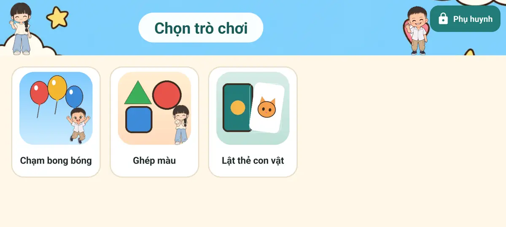
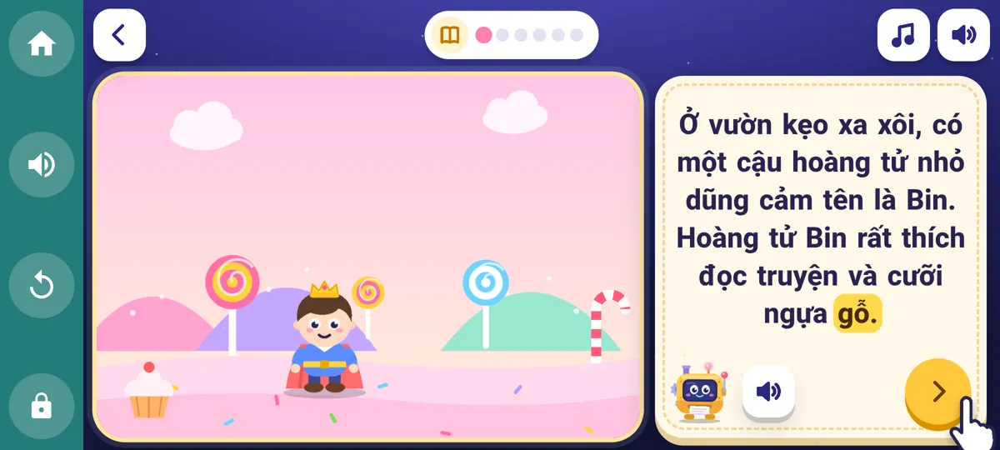
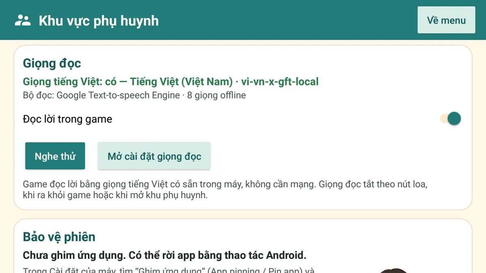

# Kids Games Player — sân chơi game HTML offline cho bé

App Android để bé chơi các **trò chơi HTML do bố mẹ tự làm bằng AI**: không mạng, không quảng cáo, không tài khoản. Bố mẹ chép thư mục game vào điện thoại, app tự nhận. Mọi cài đặt nằm sau mã PIN, bé không thoát ra ngoài được. Từ bản 1.1.0, game còn **đọc lời bằng giọng tiếng Việt** có sẵn trong máy.

**Chơi thử ngay trên trình duyệt và tải app:** website của repo này (GitHub Pages), địa chỉ dạng `https://<tài-khoản>.github.io/<tên-repo>/`. Cách bật: mục [Đưa lên GitHub và bật website](#đưa-lên-github-và-bật-website).

| Menu của bé | Game kể chuyện có giọng đọc | Khu phụ huynh |
| --- | --- | --- |
|  |  |  |

Toàn bộ dự án (app, 64 game, website, công cụ, kiểm thử) được làm cùng AI (Claude Code). Bố mẹ chỉ mô tả ý tưởng, duyệt và thử trên điện thoại.

## Trong repo có gì

| Thư mục / file | Là gì |
| --- | --- |
| `KidsGamesPlayer/` | App Android (Kotlin). Có tài liệu trong `docs/`, test, 3 game mẫu, template tạo game và công cụ đóng gói. |
| `games/` | 51 game HTML một file: mỗi thư mục có `index.html` và `icon.png`. Có kèm các prompt `Bo game 2…5.md` đã dùng để AI làm game. |
| `KidsGames-1file/` | 10 game một file viết theo SDK của app (tô chữ, tô số, pop-it, đàn gõ…). |
| `specs/` | Các bản mô tả đã giao cho AI: bible của app, brief 10 game, handover bản 1.1.0. |
| `AI_PLAYBOOK.md` | Tài liệu đưa cho AI để cùng bạn làm tiếp hoặc làm lại dự án. |
| `index.html`, `play.html`, `lam-cung-ai.html`, `site/` | Website: giới thiệu, chơi thử mọi game, tải về, hướng dẫn làm phần mềm cùng AI. Danh mục game ở `site/catalog.json`. |
| `downloads/` | `KidsGamesPlayer-v1.1.0.apk`, gói game (`KidsGames-tat-ca.zip`, `KidsGames-android8.zip`), ZIP từng game, `SHA256SUMS.txt`. |
| `tools/build_site.py` | Dựng lại danh mục và các ZIP sau khi thêm/sửa game: `python tools/build_site.py`. |

## Cài cho bé (10 phút)

1. Tải `KidsGamesPlayer-v1.1.0.apk` (mục **Tải về** trên website, hoặc thư mục `downloads/`), mở trên điện thoại, cho phép cài đặt.
2. Mở app → **Tạo PIN** phụ huynh 6 số.
3. Dùng app Files tạo thư mục `KidsGames` trong bộ nhớ máy. Trong app bấm **Chọn thư mục** → `KidsGames` → **Cho phép**.
4. Giải nén một gói game (ví dụ `KidsGames-tat-ca.zip`) rồi chép các thư mục game bên trong vào `KidsGames`; hoặc chép **cả thư mục** của từng game (ví dụ `games/Ai Song O Dau/`). Game hiện trong menu sau khoảng 20 giây.
5. **Giọng tiếng Việt**: giữ nút Phụ huynh 2 giây → nhập PIN → mục **Giọng đọc**. Nếu báo chưa có giọng: **Mở cài đặt giọng đọc** → Google → **Cài đặt dữ liệu giọng nói** → **Tiếng Việt** (tải ~9 MB một lần). Bấm **Nghe thử**.
6. Nên bật **Ghim ứng dụng** trong Cài đặt của máy, rồi trong khu phụ huynh bấm **Bắt đầu phiên cho bé**.

Hướng dẫn đầy đủ cho bố mẹ: [`KidsGamesPlayer/README_VI.md`](KidsGamesPlayer/README_VI.md). Danh sách cần tự thử trên máy thật: [`KidsGamesPlayer/docs/DEVICE_CHECKLIST.md`](KidsGamesPlayer/docs/DEVICE_CHECKLIST.md).

## Cập nhật app

Mở APK mới và chọn **Cập nhật**. **Không gỡ app cũ**: gỡ app sẽ xóa PIN, danh sách game và điểm của bé. Cài đè chỉ được khi APK mới ký cùng khóa với bản đang cài. Khóa ký **không có trong repo**; người giữ khóa phải sao lưu nó cẩn thận.

## Thêm game mới

- **Không cần APK mới.** Chép thư mục game vào `KidsGames` là xong. Muốn sửa game thì chép đè, giữ nguyên tên thư mục để không mất điểm.
- **Nhờ AI làm game:** dùng prompt [`KidsGamesPlayer/docs/GAME_AUTHORING_PROMPT.md`](KidsGamesPlayer/docs/GAME_AUTHORING_PROMPT.md) (game theo SDK), hoặc copy một file `games/Bo game N.md` rồi đổi danh sách 10 ý tưởng (game một file chạy cả trên trình duyệt). Chi tiết ở `AI_PLAYBOOK.md`.
- **Cho game lên website:** thêm một dòng vào `site/catalog.json` rồi chạy `python tools/build_site.py` (chỉ cần Python 3, không cần cài gì thêm).
- Luật quan trọng cho game: chạy offline trong một thư mục, không link ra ngoài; chơi được khi không có giọng đọc; mọi màn mở sẵn, không có thua; nếu máy là Android 8 chưa cập nhật WebView thì phải viết theo chuẩn cũ (xem bảng vấn đề bên dưới).

## Dự án được làm thế nào

1. **Đặc tả (bible)**: bố mẹ cùng AI viết một tài liệu thiết kế dài (`specs/KidsGames_Player_Claude_Code_Bible.md`), chốt mọi quyết định: Kotlin + WebView, offline, mỗi game một “origin” riêng, PIN, ghim ứng dụng.
2. **AI xây app**: giao bible cho Claude Code với câu “đọc và làm từ đầu đến cuối”. AI tự viết mã, test trên emulator Android 8 và Android 17, ký APK, viết báo cáo trung thực (PASS / FAIL / chưa chạy).
3. **AI làm game theo lô**: mỗi file prompt mô tả 10 game và tiêu chuẩn chung (dễ thương, không phạt, mở khóa hết, tự kiểm thử ở 3 cỡ màn hình). Nhiều phiên AI chạy song song, mỗi phiên một lô.
4. **Phát hiện vấn đề trên điện thoại thật**: game có giọng đọc khi mở bằng Chrome nhưng im lặng trong app.
5. **Sửa bằng handover**: một file mô tả vấn đề, quyết định và kiểm thử bắt buộc → AI làm bản 1.1.0 trọn vẹn, kể cả cài đè thử trên emulator.

Bản đầy đủ cho người lớn và vibe coder (9 nguyên tắc, cách dựng player và game, áp dụng cho game khác, công cụ nội bộ hay sản phẩm thương mại, 7 prompt mẫu): trang **Làm cùng AI** trên website, file [`lam-cung-ai.html`](lam-cung-ai.html).

## Các vấn đề đã gặp và cách xử lý

| Vấn đề | Cách xử lý |
| --- | --- |
| WebView của Android **không có giọng đọc** (`speechSynthesis` không tồn tại), nên game im lặng trong app | App tự cung cấp `speechSynthesis`: chèn một script nhỏ vào trang game, đọc bằng bộ chuyển văn bản thành giọng nói của Android, chỉ dùng giọng offline. Không sửa game nào |
| Giọng đọc phải tuân luật của app | Tắt ngay khi bấm loa, về menu, tắt màn hình, mở khu phụ huynh. Khi đang tắt tiếng, game vẫn nhận “đọc xong” đúng nhịp |
| Android 8 (WebView 69) **làm hỏng chữ có dấu** khi gửi giữa trang và app (“chó” thành ký tự lạ) | Mọi tin nhắn chỉ dùng ký tự ASCII, chữ có dấu được mã hóa `\uXXXX` |
| Google TTS **liệt kê cả giọng chưa tải** hoặc giọng cần mạng | App lọc lại, chỉ đưa giọng thật sự offline cho game |
| Game dùng CSS/JS mới (`inset`, `gap` trong flex, `?.`, `??`, `Object.fromEntries`) **vỡ trên Android 8 chưa cập nhật WebView** (Chromium 69) | Game mẫu và 10 game trong `KidsGames-1file/` viết theo chuẩn cũ; `pack_game.py` cảnh báo. 51 game trong `games/` làm cho trình duyệt mới: trên WebView 69 có 16 game không khởi động và cả 51 dùng `inset`. Máy cần “Android System WebView”/Chrome bản 87 trở lên (máy có Play Store thường tự cập nhật) |
| Chép game dở dang thì bé mở trúng bản hỏng | App chỉ chạy bản đã nạp đầy đủ và kiểm tra; bản mới lỗi thì giữ bản cũ |
| Game có thể mở link, popup, xin quyền camera… | Mọi yêu cầu ra ngoài bị chặn; app không có quyền Internet |
| Nút “Hủy” của bàn phím PIN không đóng bàn phím | Sửa lỗi đặt tên trùng trong code, thêm test |

Chi tiết từng quyết định: [`KidsGamesPlayer/docs/DECISIONS.md`](KidsGamesPlayer/docs/DECISIONS.md). Kết quả kiểm thử: [`KidsGamesPlayer/BUILD_REPORT.md`](KidsGamesPlayer/BUILD_REPORT.md).

## Đưa lên GitHub và bật website

1. Tạo repo mới trên GitHub (Public nếu muốn ai cũng xem được website; GitHub Pages của repo Private cần gói trả phí).
2. Đưa cả thư mục lên. Repo có hơn 1.000 file nên **không** kéo-thả trên web được (giới hạn 100 file mỗi lần). Dùng **GitHub Desktop**: *File → Add local repository* → chọn thư mục này → *create a repository* → *Publish repository*. Hoặc dùng git:

   ```bash
   git init -b main
   git add .
   git commit -m "Kids Games Player 1.1.0"
   git remote add origin https://github.com/<tài-khoản>/<tên-repo>.git
   git push -u origin main
   ```

3. Trên GitHub: **Settings → Pages → Build and deployment → Source: Deploy from a branch → Branch: `main`, thư mục `/ (root)` → Save**. Khoảng 1–2 phút sau website chạy ở `https://<tài-khoản>.github.io/<tên-repo>/`.

Website là file tĩnh, không cần build trên GitHub. File `.nojekyll` phải đi cùng (để các thư mục bắt đầu bằng `_` được phục vụ). Khi chơi trên web, mỗi game lưu tiến trình trong trình duyệt ở một ngăn riêng; 50 game trong `games/` tải font từ Google Fonts.

## Tự build từ mã nguồn

Cần JDK 17+ (đã dùng Temurin 21), Android SDK (platform 37, build-tools 36.0.0), Python 3. Windows:

```powershell
cd KidsGamesPlayer
.\scripts\build.ps1                # debug + unit test + lint, release + lint
.\scripts\package_delivery.ps1     # dist/: APK, ZIP nguồn, ZIP game mẫu, SHA256SUMS
```

Không có khóa ký thì bản release sẽ không ký. Tự tạo khóa mới bằng `scripts/create_signing_key.ps1`, nhưng APK ký bằng khóa mới **không cài đè** được lên app đã cài bằng khóa cũ.

## Giới hạn

- Đã kiểm thử kỹ trên emulator Android 8 và Android 17; trên máy thật mới do gia đình dùng thử.
- Ghim ứng dụng không chặn được nút nguồn hay giao diện riêng của từng hãng.
- Game cần mạng, máy chủ hoặc CDN sẽ không chạy.

## Bản quyền

Hình Gi & Shi (hai nhân vật trong app và game) là của gia đình tác giả, chỉ dùng trong dự án này. Biểu tượng Material Icons theo Apache 2.0 (`KidsGamesPlayer/THIRD_PARTY_NOTICES.md`). Repo chưa kèm file `LICENSE`, nên theo mặc định tác giả giữ mọi quyền với mã nguồn và game: bạn được xem và chơi; muốn dùng lại thì hỏi tác giả.
